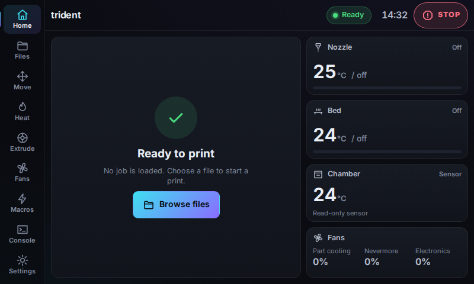
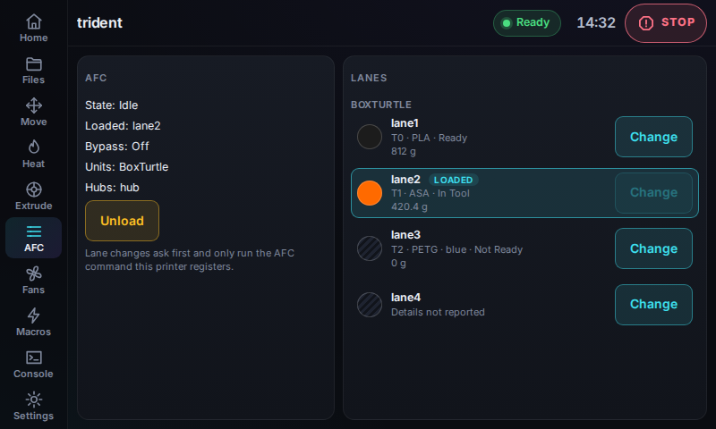
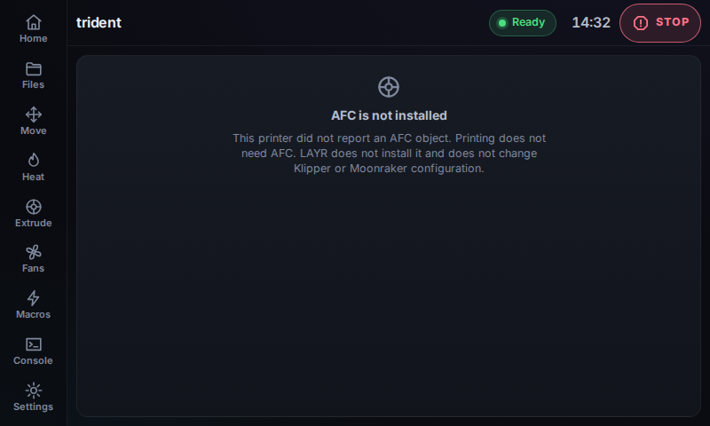
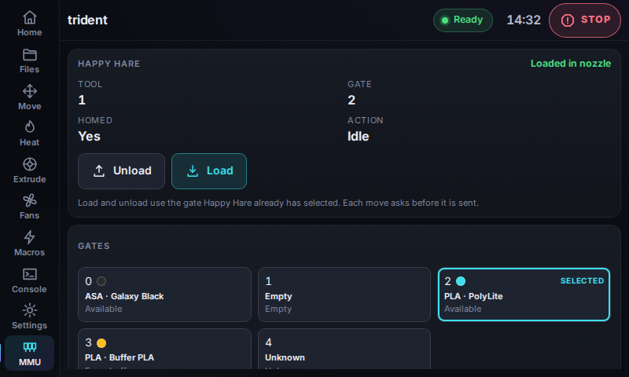
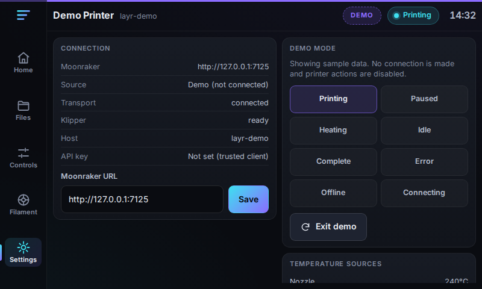

# Install LAYR on Raspberry Pi

This guide covers installing LAYR on a Raspberry Pi already running Klipper and Moonraker, with an HDMI touchscreen such as a 5-inch (often 800×480) or 7-inch (often 1024×600) display. Optional **AFC** (including Box Turtle) and **Happy Hare** integrations are supported, but LAYR does not install either controller or change your printer configuration.

Test one filament system at a time. AFC and Happy Hare are mutually exclusive in one LAYR printer profile: turning one on turns the other off. You can test the other later on the same printer, after the first switch is off, or on a different printer. Do not run both controllers at the same time. You do not uninstall LAYR to switch which one you are testing.

Use Raspberry Pi OS Bookworm or MainsailOS Bookworm, 64-bit or 32-bit armhf. Other systems stop with an error and change nothing.

## Install

On the Pi, as the printer user (the same user you use for Mainsail, often `pi`), not as root:

```bash
curl -fsSL https://raw.githubusercontent.com/EzraTechnologies/LAYR/main/deploy/bootstrap.sh -o /tmp/layr-bootstrap.sh
bash /tmp/layr-bootstrap.sh
```

Do not pipe that download into `bash` or `sudo`. Read the preflight on screen, then answer the preview question. Preview mode leaves KlipperScreen where it is.

That long command is only for the first install. When it finishes, it adds a `layr` command for your user. After you log in again, including after a reboot, type this from any directory:

```bash
layr
```

That opens the same manager. It does not download anything, and it does not use `/tmp`.

The script tells you what it found: the panel mode, whether a touchscreen is listed, whether Moonraker answered, and whether an `AFC` object, `AFC_lane` lanes, or a Happy Hare `mmu` object is present. Those checks are read-only. Nothing moves.

What this does not do:

- It does not install AFC, Happy Hare, or a Box Turtle, and it does not edit their files.
- It does not edit `printer.cfg`, `moonraker.conf`, or `mmu.cfg`.
- It does not restart Klipper or Moonraker, and it does not reboot the Pi.
- It does not force 800×480 or any other HDMI mode, and it does not change udev rules.
- It does not install the optional WebKit browser. Chromium is the one LAYR uses.

KlipperScreen stays on the panel until you confirm a second question, or until you later run the switch command below. If you want that second step in the same run, only after you have read the prompts:

```bash
bash /tmp/layr-bootstrap.sh --yes --switch-display
```

`--yes` alone installs the preview and still leaves KlipperScreen up.

Check the same report again any time. This changes nothing:

```bash
bash /tmp/layr-bootstrap.sh diagnose
```

A five-second touch sample, still read-only, writes no input rule:

```bash
bash /tmp/layr-bootstrap.sh diagnose --sample-touch
```

## The same menu again

After LAYR is installed, type `layr` from any directory. That does not download packages, build, or reinstall. It reads `~/layr/current` and the systemd units, prints which display is actually active, and shows a menu:

```text
1) Switch to LAYR
2) Switch to KlipperScreen
3) Update
4) Repair
5) Diagnostics
6) Exit
7) Uninstall LAYR
```

Exit, or running it with no terminal and no choice, changes nothing. You can run it again later and choose Exit.

Switch to LAYR and Switch to KlipperScreen call `layr-display.sh`. KlipperScreen stays installed. The menu does not remove it, and it does not install a KlipperScreen that is not already there.

Update and Repair are the choices that download or install again. They leave the display on whatever is active now.

Uninstall LAYR asks first and tells you what it removes. It turns KlipperScreen back on when that service is installed. It does not remove apt packages, Klipper, Moonraker, AFC, Happy Hare, or printer configuration. It asks a second question before it deletes personal LAYR settings and the idle-home printer photo.

If both displays are active, neither is active, or the units cannot be read, the script prints that status and does not switch by itself. You can still pick a switch from the menu when the status is both or neither. If the status cannot be read, it will not guess.

If LAYR is broken, or the kiosk is not running, Switch to KlipperScreen still runs. It does not need the LAYR page, and it does not need a network connection.

From a shell, the same choices are:

```bash
layr to-klipperscreen
layr to-layr
layr update
layr repair
layr status
layr uninstall
```

`layr status` only reads the local install. `layr to-klipperscreen` and `layr to-layr` do not download. `layr update` and `layr repair` are the ones that may use the network. `layr uninstall` asks before it removes anything. `--yes` skips that first question and still keeps settings and photos unless you also pass `--delete-browser`.

## If the Pi has no network

The switch back to KlipperScreen does not need a new copy of the installer. After the first successful install, from SSH, as the printer user, from any directory:

```bash
layr to-klipperscreen --yes
```

That command does not use GitHub, curl, `/tmp`, or the LAYR page. Use it when the panel is blank, when the kiosk has failed, or when the long install command cannot be downloaded. It still works when the LAYR page does not answer.

If `layr` itself is missing, this file is also on the Pi after a successful install:

```bash
~/layr/src/deploy/layr-display.sh to-klipperscreen --yes
```

If that file is not there either, the installer will say so and will not stop the display by some other means. Repair needs a network. A text console is Ctrl+Alt+F1, or `sudo chvt 1`. The text console does not.

## Open LAYR before you move filament

In Chromium on the Pi:

```text
http://127.0.0.1:7180/?moonraker=http://localhost:7125#/home
```

A picture of the idle home screen at 800×480 is in [docs/screenshots/800x480-home-ready.png](docs/screenshots/800x480-home-ready.png). Your panel keeps whatever mode it already had. 800×480 is common on a 5-inch screen and is not forced.

On the touchscreen, confirm:

- [ ] You can reach Home, Move, and Settings with a finger. Nothing important is cut off.
- [ ] Buttons are easy to hit. A mouse still works if one is plugged in.
- [ ] The installer did not ask you to change HDMI settings. `diagnose` says `hdmi-mode: not set` and `udev: not modified`.

Settings → Integrations is where AFC and Happy Hare are switched. Both start off. Spoolman, if you use it, can stay on with either one. Turning a switch does not move filament and does not edit Klipper.

## AFC and Box Turtle

Skip this section if this printer does not already run AFC. Leave Happy Hare off for the whole section.

- [ ] `diagnose` says `afc-object: present` when Klipper lists `AFC`. Lane names are on the `afc-lanes:` line. A Box Turtle shows up as an `afc-unit:` line such as `AFC_BoxTurtle`.
- [ ] `mmu-object:` is `absent` on this printer, or Happy Hare is switched off. `controllers:` is `afc`, not `both`.
- [ ] The `afc-status:` and `afc-lane-status:` lines match what Mainsail or Fluidd shows for the loaded lane, state, and error. This was a read-only check.
- [ ] In LAYR, Settings → Integrations → turn **AFC** on. Happy Hare stays off. The rail shows AFC. Units, lanes, the loaded lane, and any error match the printer.
- [ ] Load, lane change, and unload each ask first. Cancel sends nothing. Do this only while the printer is idle and a wrong move is safe.
- [ ] During a print those buttons stay off.
- [ ] A printer without AFC, or with the switch off, has no AFC item. `#/afc` says it is not installed.

| Home | AFC lanes | AFC off | Happy Hare | Settings |
| --- | --- | --- | --- | --- |
|  |  |  |  |  |

These pictures are the 800×480 layout from a mocked printer, not a photo of your panel.

## Happy Hare

Skip this section if this printer does not already run Happy Hare. Leave AFC off for the whole section. If you just tested AFC on this same printer, turn AFC off first. You do not reinstall LAYR.

- [ ] `diagnose` says `mmu-object: present`. `afc-object:` is `absent`, or AFC is switched off. `controllers:` is `happy-hare`, not `both`.
- [ ] `mmu-status:` shows the tool, gate, filament, action, and pause reason. `mmu-gate:` lines show each gate’s status, material, and name when Happy Hare reported them. They match `MMU_STATUS` or Mainsail. Missing fields say `not-reported`.
- [ ] In LAYR, Settings → Integrations → turn **Happy Hare** on. AFC stays off. The rail shows MMU. Home shows the same tool, gate, and filament.
- [ ] Load, unload, and tool change each ask first. Confirming Load sends only `MMU_LOAD`. Cancel sends nothing. The same for Unload and a tool change.
- [ ] If Happy Hare is paused on a real error, the pause reason matches. Recover, when it is shown, sends only `MMU_RECOVER` after you confirm.
- [ ] During a print those buttons stay off.
- [ ] With the switch off, or with no `mmu` object, the rail has no MMU item and nothing moves.

Screenshots at 800×480: [docs/screenshots/800x480-mmu.png](docs/screenshots/800x480-mmu.png), [800x480-mmu-error.png](docs/screenshots/800x480-mmu-error.png), [800x480-mmu-printing.png](docs/screenshots/800x480-mmu-printing.png).

## Both systems

- [ ] If `diagnose` says `controllers: both`, both objects are already on this Klipper. LAYR still did not start them. Turn on only the one this printer should use. Leave the other switch off.
- [ ] Do not enable both switches. The Settings screen keeps only one of AFC or Happy Hare on.
- [ ] To test the other system, turn the first switch off and use a printer that actually runs that system, or come back later. Do not uninstall LAYR, and do not try to run both controllers together.

More detail is in [docs/trident-checklist.md](docs/trident-checklist.md) and [docs/happy-hare.md](docs/happy-hare.md).

## Put LAYR on the panel, and how to undo it

Only after the preview looks right in Chromium, run `layr` and choose Switch to LAYR, or run:

```bash
layr to-layr
```

Choosing that menu item, or running `layr to-layr`, stops KlipperScreen and starts LAYR. KlipperScreen stays installed. If the LAYR kiosk does not stay up, KlipperScreen is turned back on. The command uses `layr-display.sh`. It does not keep a second copy of the stop and start steps.

Switch back from the `layr` menu, or, with no network and no new download:

```bash
layr to-klipperscreen --yes
```

Previous LAYR build. This leaves the `layr` command in place:

```bash
~/layr/src/deploy/rollback.sh --yes
```

Remove LAYR from the menu: choose **Uninstall LAYR**. The same action from SSH is:

```bash
layr uninstall
```

Read the summary before you answer. It turns KlipperScreen back on first when that service is installed. If KlipperScreen is not installed and the LAYR kiosk is what is on the screen, uninstall stops and leaves the panel as it is. Uninstall removes LAYR services, the releases under `~/layr`, and the `layr` command. It does not remove apt packages that were already on the Pi, and it does not remove Klipper, Moonraker, AFC, Happy Hare, `printer.cfg`, `moonraker.conf`, or `mmu.cfg`.

A second question asks before deleting personal settings and printer photos (`~/.config/layr-chromium`). The default is to keep them. `--yes` alone also keeps them. Add `--delete-browser` only when you want those deleted too.

An older install that does not have `layr` yet can still run:

```bash
~/layr/src/deploy/uninstall.sh
```

`--purge` on that script also removes `~/layr` and the `layr` command. It still keeps personal settings and printer photos.

A text console is Ctrl+Alt+F1, or `sudo chvt 1`. None of these commands edit `printer.cfg`, `moonraker.conf`, or `mmu.cfg`.

## If something stops

| What you see | What to do |
| --- | --- |
| `incomplete copy` | Download `/tmp/layr-bootstrap.sh` again. A short file does not install anything. |
| It says to run as the printer user, not root | Log in as `pi` (or your Mainsail user) and run the two lines again. Do not use `sudo bash`. |
| The OS is not supported | Stay on Pi OS Bookworm or MainsailOS Bookworm. Nothing was changed. |
| apt is locked or `apt-failed=yes` | Wait for the other installer to finish, then run the same command again. The display was not switched. |
| Moonraker did not answer | Start Moonraker the way you usually do. LAYR did not edit `moonraker.conf`. If the browser blocks the page, add `*://localhost:*` to `cors_domains` yourself. |
| The panel is blank, or the LAYR kiosk failed | From SSH, as the printer user: `layr to-klipperscreen --yes`. This does not download the installer and does not need the LAYR page. If `layr` is not found: `~/layr/src/deploy/layr-display.sh to-klipperscreen --yes`. The Pi was not rebooted. |
| The installer says both displays, neither display, or an unknown status | It prints that status and does not switch by itself. Pick a menu item only when you mean that display. If the status cannot be read, it will not switch. |
| KlipperScreen is not installed | The menu will not stop LAYR in order to switch to it. LAYR does not install or remove KlipperScreen. |
| You already installed LAYR and `layr` started apt or a build | Choose Exit. Update and Repair are the menu items that install again. A plain `layr` or `layr status` does not. |
| `layr: command not found` after the first install | Log in again, or open a new terminal. The command is `~/.local/bin/layr`. An install from before this command existed needs the long install command one more time; choose Exit and the command is added without a reinstall. |
| No touchscreen is listed | `diagnose` prints `touch: none listed`. Cable and the screen’s own overlay are unchanged; LAYR did not write an input rule. |
| Resolution looks wrong | LAYR did not write an HDMI mode. The panel keeps the mode the Pi already chose. |
| AFC or Happy Hare is missing in LAYR | The switch for that system is still off, or Klipper did not list the object. LAYR does not install the controller. |
| You need the other filament system | Turn the current one off in Settings, or open LAYR on the other printer. Do not enable both. |
