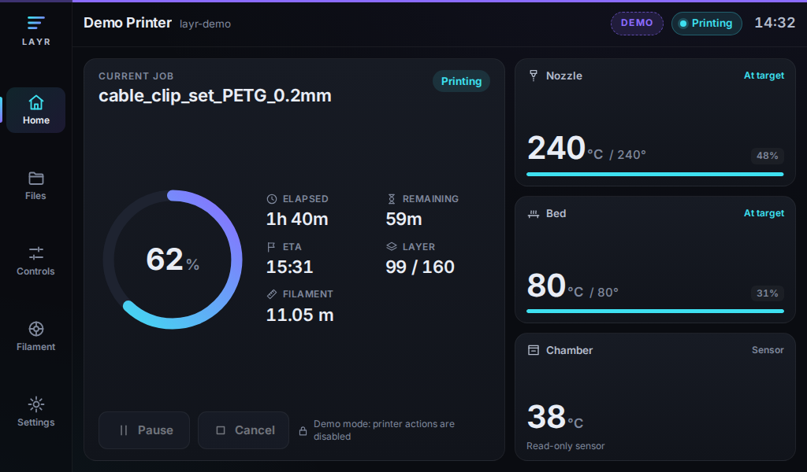
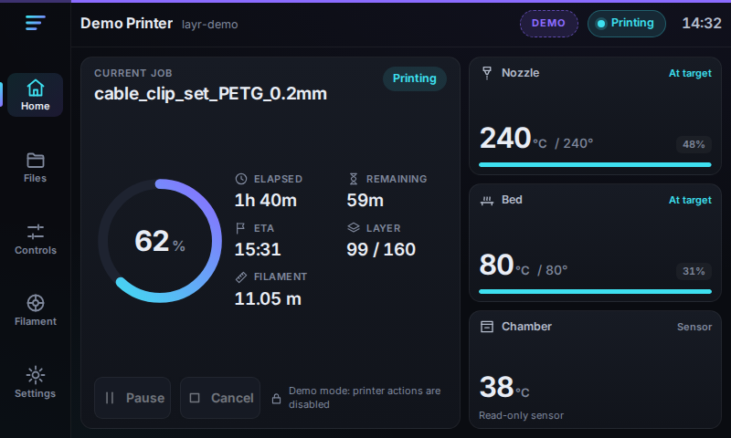
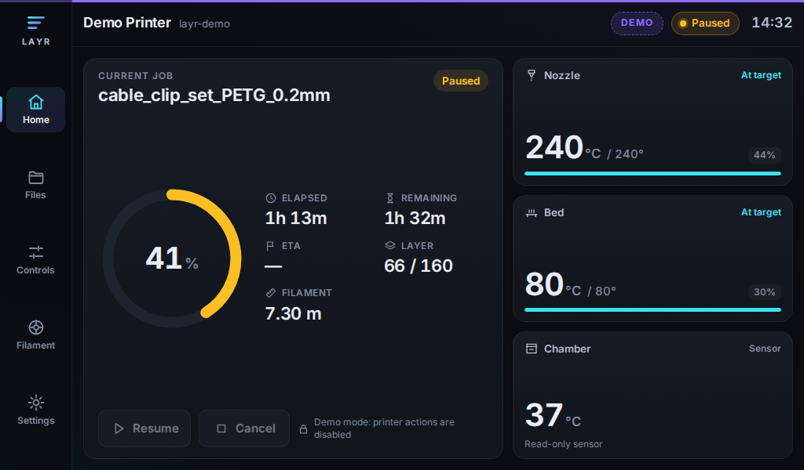
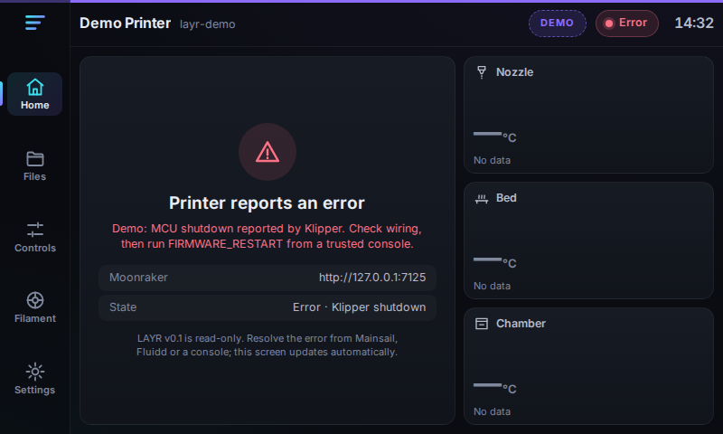
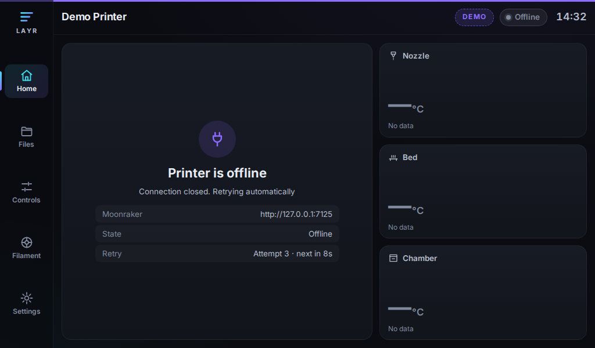
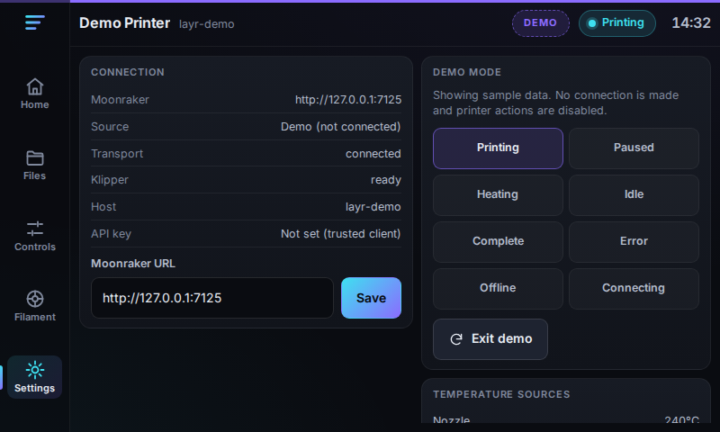

# LAYR

LAYR is an open-source, touch-first Klipper interface for Raspberry Pi displays. It talks to
[Moonraker](https://moonraker.readthedocs.io/) and is designed for 7-inch HDMI touchscreens such as the
BTT HDMI7 (1024×600) and common 800×480 panels.

**Status: v0.1 (read-only preview).** LAYR shows live printer state. It does not send G-code, start or stop
prints, or change any Klipper, Moonraker or KlipperScreen configuration.

| 1024×600 | 800×480 |
| --- | --- |
|  |  |
|  |  |
|  |  |

All screenshots are captured from the real app in demo mode by `npm run screenshots`. Demo data is sample data.

## What v0.1 does

- **Dashboard**: printer name and host, connection status, print state, progress ring, job filename,
  elapsed time, remaining time and ETA, layer count, filament used, nozzle and bed temperatures, and an
  optional chamber sensor.
- **Moonraker client** (WebSocket JSON-RPC): identifies as a `display` client, lists the printer's objects,
  subscribes only to objects that exist, follows Klippy state changes (`startup`, `ready`, `shutdown`,
  `error`, `disconnected`), and reconnects with bounded exponential backoff (1 s doubling to 30 s, with jitter).
- **Statuses**: `Offline`, `Connecting`, `Ready`, `Printing`, `Paused` and `Error`, each with a short explanation.
- **Demo mode**: deterministic sample states for screenshots, CI and evaluation. Demo mode is labelled on screen
  and never opens a socket or sends a request.
- **Navigation placeholders** for Files, Controls and Filament. Settings shows connection diagnostics, lets you
  change the Moonraker URL and lets you switch demo scenarios.

## Safety model

- The Moonraker client only allows a fixed list of read-only methods (`READ_ONLY_METHODS` in
  `src/lib/moonraker/client.ts`). Any other method, such as `printer.gcode.script` or `printer.print.cancel`,
  is rejected before anything is sent. Unit tests enforce this.
- Every printer action has to go through a `CommandGateway` (`src/lib/actions/commands.ts`). In v0.1 both
  gateways block everything: live mode reports "not available in v0.1" and demo mode reports "demo". The Pause,
  Resume and Cancel buttons are visible but disabled, with the reason shown next to them.
- LAYR does not write files, run macros or change any configuration.

## Quick start

Requires Node.js 22.12 or newer.

```bash
npm ci
npm run dev                 # http://localhost:5173, connects to http://localhost:7125 by default
npm run dev:demo            # same, opened in demo mode (/?demo=printing); no printer needed
```

To use a printer on your network, open
`http://localhost:5173/?moonraker=http://<printer-host>:7125`. See [Moonraker access](#moonraker-access) if
the connection is refused.

### Scripts

| Script | Purpose |
| --- | --- |
| `npm run dev` / `npm run dev:demo` | Vite dev server (live / demo) |
| `npm run build` | Production bundle in `dist/` (static files, relative paths) |
| `npm run preview` | Serve the production bundle on port 4173 |
| `npm run check` | `svelte-check` type check of the app and tests (warnings fail the check) |
| `npm test` | Vitest unit tests |
| `npm run test:e2e` | Playwright layout and behaviour tests at 1024×600 and 800×480 (also refreshes screenshots) |
| `npm run screenshots` | Regenerate `docs/screenshots/` only |
| `npm run verify` | check + test + build |

Run `npx playwright install chromium` once before the first e2e run.

## Configuration

All settings are optional.

### Build-time environment variables

Copy `.env.example` to `.env.local`:

| Variable | Default | Description |
| --- | --- | --- |
| `VITE_LAYR_MOONRAKER_URL` | `http(s)://<page host>:7125` | Moonraker base URL. `http`, `https`, `ws` and `wss` are accepted. |
| `VITE_LAYR_PRINTER_NAME` | Klipper host name | Name shown in the top bar. |
| `VITE_LAYR_API_KEY` | none | Moonraker API key, exchanged for a oneshot token before connecting. **This key is embedded in the built JavaScript.** Prefer `trusted_clients` for a local kiosk. |
| `VITE_LAYR_DEMO` | off | Start in demo mode with a scenario (see below). |

### Runtime overrides

| Mechanism | Example | Notes |
| --- | --- | --- |
| URL parameter | `?moonraker=http://voron.local:7125` | Highest precedence. |
| Settings screen | Moonraker URL field, then **Save** | Stored in `localStorage` on that device. **Reset** clears it. |
| Demo parameter | `?demo=paused` | Scenarios: `printing`, `paused`, `heating`, `ready`, `complete`, `error`, `disconnected`, `connecting`. `?demo=off` forces live mode. |
| Page | `#/home`, `#/files`, `#/controls`, `#/filament`, `#/settings` | Hash routes. |

Precedence for the Moonraker URL: URL parameter, then saved setting, then build variable, then the default.

### Moonraker access

LAYR never edits `moonraker.conf`. Depending on how you serve LAYR, you may need to make one of these changes
yourself:

- **Authorization.** For a kiosk on the printer's own Pi, the simplest option is that Moonraker trusts the
  local client. Check that `[authorization] trusted_clients` covers `127.0.0.1` (most MainsailOS and FluiddPi
  images already do this). Use `VITE_LAYR_API_KEY` only on a trusted network, because anyone who can load the
  page can read the key.
- **CORS.** If LAYR is served from a different origin than Moonraker (for example `http://pi.local:8080`
  talking to `http://pi.local:7125`), add that origin to `[authorization] cors_domains`.

If neither is set up, the dashboard shows **Printer is offline** and keeps retrying with backoff.

## Architecture

```
src/
  main.ts, App.svelte           Entry point, hash routing, layout shell
  app.css                       Theme tokens (CSS variables) and the 800×480 size step
  components/                   NavRail, TopBar, JobCard, TemperatureCard, ConnectionCard, ProgressRing, Icon
  views/                        Dashboard, Settings, Placeholder (Files / Controls / Filament)
  lib/
    config.ts                   Config resolution and PrinterProfile (multi-printer ready)
    moonraker/
      client.ts                 WebSocket JSON-RPC client: auth, identify, subscribe, Klippy tracking, backoff
      backoff.ts                Bounded exponential backoff
      objects.ts                Which Klipper objects and fields are subscribed; handles missing objects
      mapping.ts                Pure mapping from Klipper objects to the view model
    printer/
      model.ts                  PrinterState and status derivation
      assemble.ts               Raw status to PrinterState (shared by the live and demo sources)
      source.ts                 PrinterSource interface
      liveSource.ts             Moonraker-backed source; coalesces updates (at most 4 per second)
      store.svelte.ts           Svelte 5 runes store; patches only changed fields
      createSource.ts           Picks the demo or live source and its command gateway
    demo/                       Deterministic scenarios and DemoSource
    actions/commands.ts         CommandGateway (blocks everything in v0.1)
    spoolman/types.ts           Spoolman service contract (not implemented)
tests/                          Vitest unit tests with a fake Moonraker
e2e/                            Playwright layout, behaviour and screenshot tests
```

**Rendering cost.** Moonraker can push status several times per second. The live source merges those diffs and
updates the UI at most every 250 ms. The store writes only values that changed, temperatures are shown as whole
degrees, and durations drop seconds above 10 minutes, so most updates touch only a few text nodes. The UI has
no looping animations, shaders or canvas. Its only transitions are short one-off progress and meter
transitions, and those are disabled under `prefers-reduced-motion`.

**Multi-printer.** State, sources and gateways are keyed by `PrinterProfile.id`. A future printer switcher
creates one `PrinterStore` per profile.

**Spoolman (planned, not implemented).** `src/lib/spoolman/types.ts` defines the contract for these features:
browse spools, select the active spool for a printer, and clear the active spool only after the user has
confirmed a successful unload. These are write operations, so they will go through a confirmed command path and
stay disabled in demo mode.

## Raspberry Pi kiosk installation plan

> This is a **plan** for review. It has not been run on a target device. Nothing in this repository changes a
> Pi, a printer or KlipperScreen. Test on a spare SD card first.

1. **Build** on a workstation: `npm ci && npm run build`. The `dist/` folder is a static site with relative
   paths.
2. **Copy** it to the Pi, for example `rsync -a --delete dist/ pi@printer.local:~/layr/`.
3. **Serve** it locally. On MainsailOS or FluiddPi, nginx is already installed. Add a separate server block,
   such as `/etc/nginx/sites-available/layr` with `listen 8080; root /home/pi/layr; index index.html;`, then
   enable it and reload nginx. Leave the existing Mainsail or Fluidd site unchanged. If the origin differs from
   Moonraker's, add `http://localhost:8080` to `cors_domains` (see [Moonraker access](#moonraker-access)).
4. **Kiosk session.** Install `cage` and `chromium` on Raspberry Pi OS Bookworm Lite, then run Chromium full
   screen from a systemd service or user session:
   `cage -- chromium --kiosk --noerrdialogs --disable-infobars --touch-events=enabled --overscroll-history-navigation=0 "http://localhost:8080/?moonraker=http://localhost:7125"`.
5. **Display.** The BTT HDMI7 usually reports 1024×600 over EDID with KMS. Set a manual mode in
   `/boot/firmware/config.txt` only if detection fails, and check touch orientation in landscape.
6. **KlipperScreen.** KlipperScreen and LAYR cannot share the display. Decide whether to stop KlipperScreen
   (`sudo systemctl disable --now KlipperScreen`) only after LAYR works in a browser. To roll back, disable the
   LAYR kiosk service and re-enable KlipperScreen.
7. **Screen blanking.** Not handled in v0.1. A static dim mode is planned. There will be no animated
   screensaver.

## Testing against a real Moonraker host

The automated tests use a fake Moonraker (unit tests) and a mocked WebSocket (Playwright). Before relying on
LAYR, check these on real hardware:

- Connection through `trusted_clients`, through an API key, and from a different origin with `cors_domains`.
- `FIRMWARE_RESTART` and `RESTART`: the status moves through Connecting to Ready. Emergency stop and MCU errors
  show the Klipper message as Error.
- Restarting Moonraker, rebooting the Pi and dropping Wi-Fi: the retry counter rises, delays stay at 30 s or
  less, and the connection recovers.
- A full print (start, pause, resume, cancel, complete). Compare progress, ETA and layer values with Mainsail
  or Fluidd. Layer numbers need `SET_PRINT_STATS_INFO` from the slicer or start G-code.
- Printers without `heater_bed`, with differently named chamber sensors, or with many temperature sensors.
- Long or nested filenames.
- Touch accuracy, Chromium CPU and memory on the target Pi model, and stability over a 24-hour run.

## Known limitations

- Read-only: there are no motion, temperature, file or print controls yet.
- One printer per instance. The data model is ready for more.
- Progress comes from `display_status.progress` (falling back to `virtual_sdcard.progress`). Unlike Mainsail,
  it does not exclude file headers, so values can differ slightly. ETA uses the slicer estimate early in a
  print and a progress-based estimate after 5%.
- No file thumbnails, file browser, macros, console or Spoolman integration.
- There is no on-screen keyboard. Editing the URL in Settings on a touch-only kiosk needs a USB keyboard, so
  prefer the URL parameter or the build variable.
- `VITE_LAYR_API_KEY` is visible to anyone who can load the page.
- Pinch zoom is disabled (`user-scalable=no`) to prevent accidental zoom on a kiosk.
- Only tested in Chromium (desktop, headless). Not yet tested on a Raspberry Pi or a physical BTT display.
- No license has been chosen for the repository yet.
