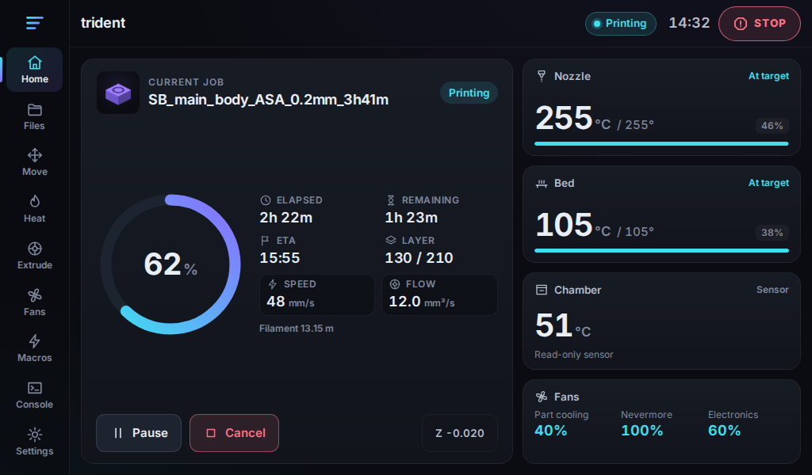
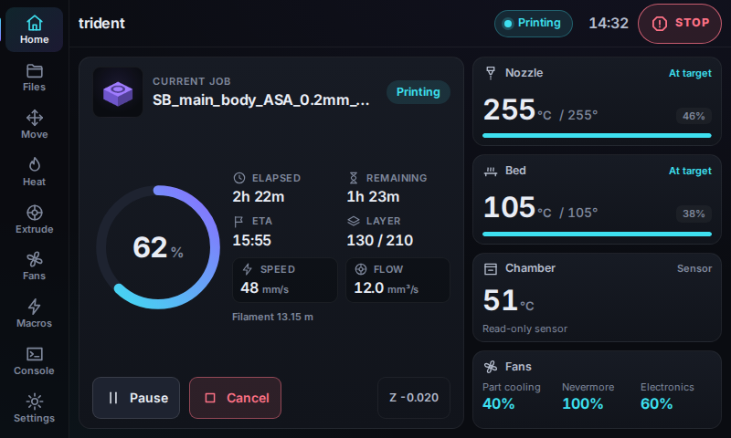
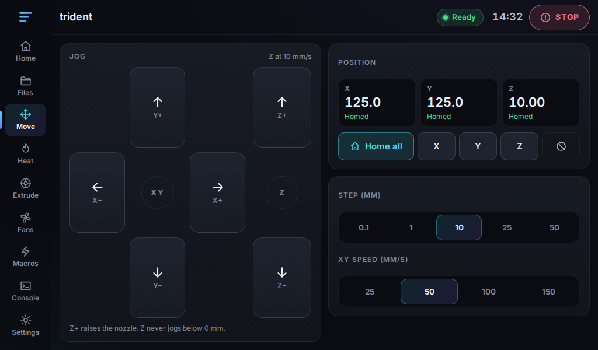
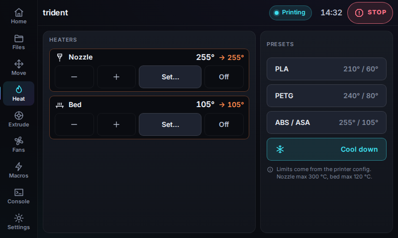
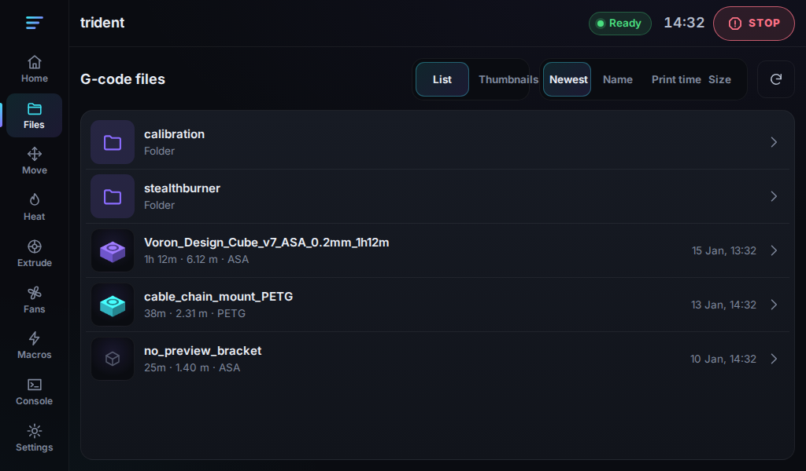
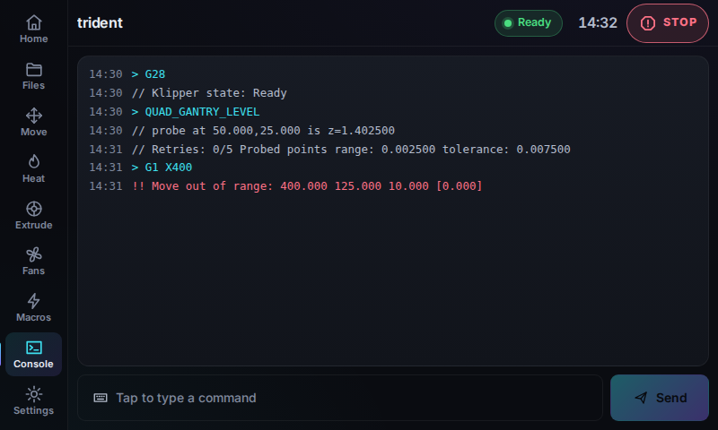
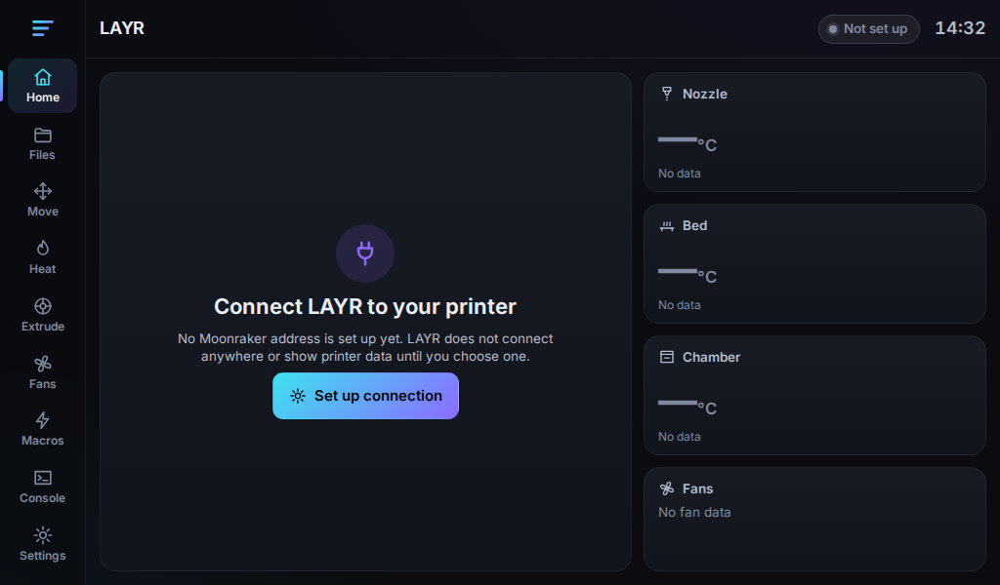
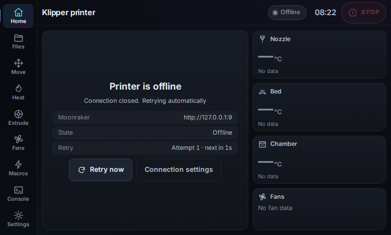

# LAYR

LAYR is an open-source, touch-first Klipper interface for Raspberry Pi displays. It talks to
[Moonraker](https://moonraker.readthedocs.io/) and is aimed at 7-inch HDMI touchscreens such as the
BTT HDMI7 (often 1024×600) and common 800×480 panels. The layout follows the display's real size;
it does not assume a resolution.

**Status: v0.2 (Trident pilot).** LAYR can jog, heat, start and stop prints, run macros, and send
console commands. It has not been run on a Voron Trident or any other physical printer. Do not
deploy it over KlipperScreen until you have checked it in a browser. See
[docs/trident-checklist.md](docs/trident-checklist.md).

Spoolman (browse spools, set the active spool, clear it only after a confirmed unload) is defined
in `src/lib/spoolman/types.ts` and is **not implemented**.

| 1024×600 | 800×480 |
| --- | --- |
|  |  |
|  |  |
|  |  |
|  |  |

Screenshots are captured from the production bundle talking to a mocked Moonraker
(`npm run screenshots`). They are fixture data, not a recording of a printer.

## What v0.2 does

- **Home**: printer display name, connection and print state, progress, filename, the active
  G-code thumbnail, layer, elapsed and remaining time, live toolhead speed (mm/s) and live
  volumetric flow (mm³/s), nozzle, bed and chamber (when that sensor exists), fans, and the
  latest console alert. Speed and flow are Klipper `motion_report` values, not the M220/M221
  percentages. Those percentages sit behind the speed and flow readouts.
- **Files**: G-code folders, sort, metadata, thumbnails (including nested paths), start and delete.
  Both ask before acting. Files without a thumbnail show a placeholder.
- **Move**: home X, Y, Z or all; jog with step size and speed; position and homed state; motors off;
  Z-offset babysteps while a print is running (ordinary jogging is blocked during a print).
- **Heat**: targets, presets, and cool-down, clamped to the printer's configured limits. High targets
  and changes during a print ask first.
- **Extrude**: extrude and retract with a cold-extrusion lockout. Load and unload appear only when
  those macros exist, and success is reported only after Klipper accepts the macro.
- **Fans**: part cooling and other controllable fans, plus lights when the config actually has them.
  Sliders send a command when released.
- **Macros**: discovered from the printer. Names starting with `_` are hidden unless you ask for them.
  A macro that needs parameters opens the console instead of being sent empty.
- **Console**: recent Moonraker G-code history, an on-screen keyboard, and a confirmation before every
  line. Nothing in a file is executed just by being displayed.
- **Settings**: Moonraker URL, display name, reconnect, theme, hide cursor, and a dim timeout.
  The display name is stored on this screen and does not change the Linux hostname. Restart and
  firmware restart are confirmed. Emergency stop is a press-and-hold in the top bar.

There is no Demo mode. With no Moonraker URL, the UI stays on "not set up" and does not invent
temperatures or positions. A dropped connection shows Offline and keeps retrying; it never substitutes
sample data.

## Safety

- Every printer-changing action goes through `prepareCommand` (`src/lib/actions/commands.ts`) and then
  `CommandGateway`. The gateway re-checks the latest state, requires confirmation where the plan says
  so, and ignores a second tap while that command group is still running.
- The Moonraker client only sends methods in `READ_METHODS` or `CONTROL_METHODS`
  (`src/lib/moonraker/client.ts`). `machine.*`, `server.restart`, config writes and file uploads are
  rejected in the client. Deleting a G-code file is allowed, and only after confirmation, and not while
  that file is the active print.
- Motion: an axis must be homed before it can jog. XY travel uses the reported position limits. Z jogging
  does not go below 0 even if `position_min` is negative. A single jog is at most 100 mm. Homing Z alone
  is refused until X and Y are homed.
- Extrusion is refused below `min_extrude_temp`, capped at 100 mm, and blocked while printing.
- Console input is one line, at most 256 characters, with no control characters. `M112` uses
  `printer.emergency_stop` instead of waiting in the G-code queue. Risky commands (restarts, meshes,
  `FORCE_MOVE`, and similar) get a stronger warning.
- Emergency stop is not behind a dialog. The button has to be held so a stray tap does not fire it.
- LAYR does not write `printer.cfg` or `moonraker.conf`, and the install scripts do not stop
  KlipperScreen unless you run `deploy/layr-display.sh to-layr`.

## Quick start

Requires Node.js 22.12 or newer.

```bash
npm ci
npm run dev          # http://localhost:5173
npm run build        # static files in dist/
```

On first launch the dashboard asks for a Moonraker URL. You can also open
`http://localhost:5173/?moonraker=http://<printer-host>:7125`.

| Script | Purpose |
| --- | --- |
| `npm run dev` | Vite dev server |
| `npm run build` / `npm run preview` | Production bundle, then serve it |
| `npm run check` | `svelte-check` (warnings fail) |
| `npm test` | Vitest unit tests |
| `npm run test:e2e` | Playwright layout, behaviour and screenshots at 1024×600 and 800×480 |
| `npm run screenshots` | Regenerate `docs/screenshots/` |
| `npm run verify` | check + test + build |

Run `npx playwright install chromium` once before the first e2e run.

## Configuration

Copy `.env.example` to `.env.local`. All variables are optional.

| Variable | Default | Description |
| --- | --- | --- |
| `VITE_LAYR_MOONRAKER_URL` | none | Moonraker base URL. `http`, `https`, `ws` and `wss` are accepted. |
| `VITE_LAYR_PRINTER_NAME` | Klipper host name | Name shown in the top bar. |
| `VITE_LAYR_API_KEY` | none | Moonraker API key, exchanged for a oneshot token. **Embedded in the built JavaScript.** Prefer `trusted_clients` on a local kiosk. |

| Mechanism | Example | Notes |
| --- | --- | --- |
| URL parameter | `?moonraker=http://voron.local:7125` | Highest precedence. |
| Settings screen | Moonraker URL field, then **Save** | Stored in `localStorage` on that device. **Reset** clears it. The API key is never stored there. |
| Page | `#/home`, `#/files`, `#/move`, `#/heat`, `#/extrude`, `#/fans`, `#/macros`, `#/console`, `#/settings` | Hash routes. |

URL precedence: query parameter, then saved setting, then the build variable. If none is set, LAYR does
not connect.

### Moonraker access

LAYR never edits `moonraker.conf`. Depending on how you serve it, you may need one of these yourself:

- **Authorization.** On the printer's own Pi, `[authorization] trusted_clients` should include
  `127.0.0.1`. Most MainsailOS and FluiddPi images already do this.
- **CORS.** A page served from a different origin (for example `http://pi.local:7180` talking to
  `http://pi.local:7125`) must be listed in `cors_domains`. `*://localhost:*` covers localhost.

The installed web server binds to `127.0.0.1` only, so other machines on the network cannot open that
copy of LAYR. Do not put LAYR on a LAN-wide port without an API key: the console can send G-code.

## Raspberry Pi install

This has **not** been run on a Pi. Test on a spare card first, and test in a browser before the kiosk.
`deploy/check-device.sh` only reads the system.

1. On a workstation: `npm ci && npm run build`.
2. Copy the repo (or at least `dist/` and `deploy/`) to the Pi.
3. As the printer user, not root: `./deploy/install.sh --dist ./dist` from the repo directory,
   or `./deploy/install.sh --dist /absolute/path/to/dist`. A relative `--dist` is resolved from the
   directory you ran the command in. The default, with no `--dist`, is the `dist/` next to `deploy/`.
   This installs `layr-web.service` on `127.0.0.1:7180` and installs `layr-kiosk.service` **disabled**.
   It copies the launcher into `~/layr/bin/` and refreshes that copy on every later install.
   KlipperScreen is not touched. No printer file is edited. Klipper and Moonraker are not restarted.
   If the web server was already running, only `layr-web.service` is restarted so the new files are served.
   A later install does not disable or restart a kiosk you already enabled with `to-layr`.
4. Open `http://127.0.0.1:7180/?moonraker=http://localhost:7125#/home` in Chromium and work through
   [docs/trident-checklist.md](docs/trident-checklist.md).
5. Only then, if you want LAYR on the panel: `./deploy/layr-display.sh to-layr`.
   That disables KlipperScreen (it stays installed) and starts cage + Chromium on tty7.
   `./deploy/layr-display.sh to-klipperscreen` switches back.
6. `./deploy/rollback.sh` restores the previous UI build. `./deploy/uninstall.sh` removes the LAYR
   units and, if LAYR had disabled KlipperScreen, enables it again. `--purge` also deletes `~/layr`.

The kiosk does not force a resolution. cage uses the connector's preferred mode. The Pi model and the
panel's native mode are read by `check-device.sh` because they are not known in this repository.

Chromium is the default renderer. An optional Cog / WPE WebKit path exists and is not enabled unless
you run `deploy/layr-engine.sh use wpe` after `check` succeeds. It does not install packages and does
not change boot. `deploy/layr-engine.sh rollback` saves Chromium again. See
[docs/pi-test.md](docs/pi-test.md). That procedure has not been run on a Pi.

Hide pointer asks the page to use a transparent cursor. On Cage, the BTT HDMI7's touch device is also
a pointer, so the compositor can keep drawing an arrow after CSS `cursor: none`. When the setting is
on, the kiosk starts Cage with a blank cursor theme (`WLR_NO_HARDWARE_CURSORS=1`). Touch is not
disabled, and a physical mouse still clicks. With the setting off, the normal cursor theme is left
alone. This has not been confirmed on the HDMI7. Restarting `layr-kiosk.service` applies the theme;
that does not restart Klipper.

## Architecture

```
src/
  App.svelte                    Hash routing, confirmation, toasts, dim overlay
  components/                   Nav rail, job, temperatures, jog helpers, keyboard, e-stop
  views/                        Home, Files, Move, Heat, Extrude, Fans, Macros, Console, Settings
  lib/
    config.ts                   URL resolution. No implicit endpoint.
    moonraker/                  WebSocket client, subscriptions, status and control mapping
    printer/                    PrinterState, live source, throttled store
    actions/                    prepareCommand (pure) and CommandGateway (the only write path)
    files/                      Directory listing, metadata, thumbnail URLs
    console/                    G-code history
    spoolman/types.ts           Contract only; not implemented
deploy/                         check, install, display switch, rollback, uninstall
tests/                          Vitest, with a fake Moonraker
e2e/                            Playwright against the production bundle and a mock socket
```

Moonraker status is merged and applied at most every 250 ms. The store writes only fields that
changed. There are no looping animations; `prefers-reduced-motion` disables the short progress
transitions.

## Testing on real hardware

Automated tests use a fake Moonraker and a mocked WebSocket. Before relying on LAYR, use the
[Trident checklist](docs/trident-checklist.md). In particular: trusted clients and CORS, homing and
jog limits against Mainsail or Fluidd, a real pause/resume/cancel, thumbnails for nested files,
firmware restart, and a Wi-Fi drop. Touch accuracy, CPU and memory on the Pi are unverified.

## Known limitations

- Not yet run on a Raspberry Pi, a BTT panel, or a Voron Trident. Live speed and flow are
  Klipper's reported `motion_report` values (interpolated by Klipper), not a separate sensor.
- The Cage pointer workaround (blank cursor theme) is not confirmed on the BTT HDMI7. CSS hiding
  works in a normal browser. The kiosk path is what still needs a hardware check.
- WPE / Cog is optional, off by default, and was not launched on Bookworm hardware here. Debian
  Bookworm's `wpewebkit` package has no security support. WebKitGTK is a different port and is not used.
- One printer per instance.
- Progress comes from `display_status.progress` (falling back to `virtual_sdcard.progress`) and can
  differ slightly from Mainsail, which skips file headers. Layer numbers need `SET_PRINT_STATS_INFO`.
- File upload is not implemented. Delete and print-start are.
- Spoolman is not implemented.
- `VITE_LAYR_API_KEY` is visible to anyone who can load the page.
- Pinch zoom is disabled for kiosk use.
- No license has been chosen yet.
